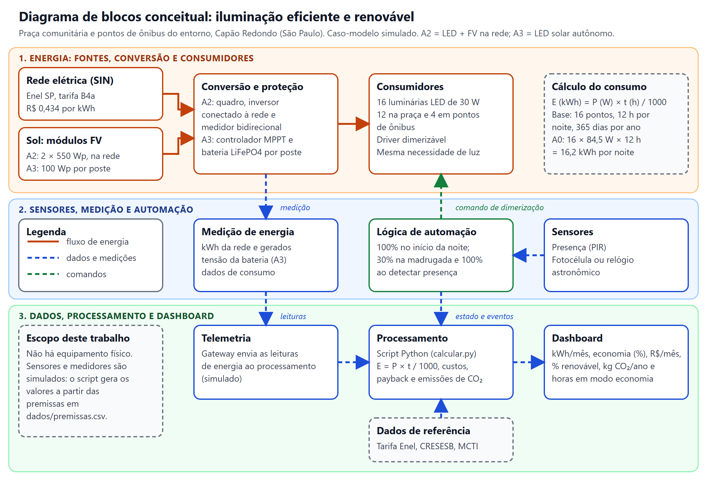
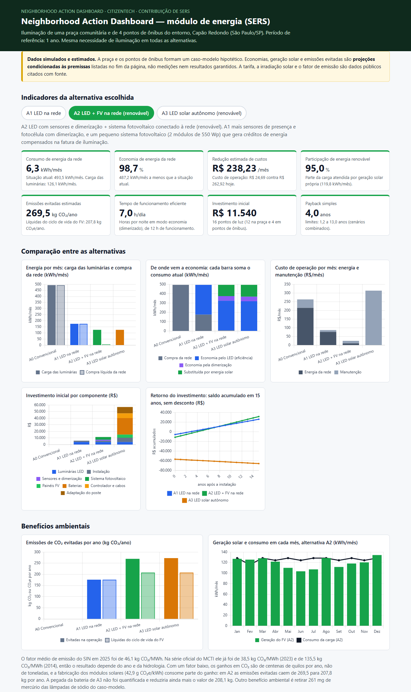

# Neighborhood Action Dashboard: módulo de energia (SERS)

**Contribuição de Soluções em Energias Renováveis e Sustentáveis (SERS) ao desafio integrador Neighborhood Action Dashboard (CitizenTech).**
FIAP, Ciência da Computação, 1º ano, Global Solution 2026.2, turma 1CCPS.

> Este repositório contém **somente a contribuição de SERS**. Se este módulo for incorporado a um repositório compartilhado com outras disciplinas, esta pasta é o módulo de energia.
> O bairro é real (Capão Redondo, São Paulo/SP), mas **a praça, os pontos de ônibus, as quantidades e os sensores são um caso-modelo simulado**. Economias, geração solar e emissões evitadas são **projeções condicionadas às premissas** de [`dados/premissas.csv`](dados/premissas.csv), não resultados garantidos.

## 1. Autor

Entrega individual.

| Nome completo | RM | Turma |
|---|---|---|
| Vinícius Alves de Souza | 575576 | 1CCPS |

## 2. Resumo

Este estudo compara **quatro formas de atender à mesma necessidade de iluminação** (16 pontos de luz, 12 h por noite, 365 dias, período de referência de 1 ano):

| Id | Alternativa | Fonte de energia |
|---|---|---|
| A0 | Situação atual: lâmpadas de vapor de sódio de 70 W com reator | Rede |
| A1 | Retrofit para LED de 30 W, sem dimerização | Rede |
| A2 | LED com sensores de presença e dimerização + 2 módulos fotovoltaicos (1,10 kWp) conectados à rede | Rede e sol (**renovável**) |
| A3 | LED solar autônomo por poste (painel, bateria LiFePO4, controlador), com sensores e dimerização | Sol (**renovável**) |

Principais números (valores gerados por [`src/calcular.py`](src/calcular.py); tabelas completas na seção 6):

<!-- AUTO:resumo:inicio -->
| Indicador | A0 Convencional | A1 LED na rede | A2 LED + FV na rede | A3 LED solar autônomo |
|---|---:|---:|---:|---:|
| Compra líquida da rede (kWh/mês) | 493,5 | 175,2 | 6,3 | 0,0 |
| Economia de energia da rede (%) | 0,0 | 64,5 | 98,7 | 100,0 |
| Participação de energia renovável (%) | 0,0 | 0,0 | 95,0 | 100,0 |
| Custo de operação (R$/mês) | 262,92 | 86,73 | 24,69 | 313,33 |
| Redução de custo (R$/mês) | 0,00 | 176,18 | 238,23 | -50,42 |
| Investimento (R$) | 0 | 5.920 | 11.540 | 56.960 |
| Payback simples (anos) | - | 2,8 | 4,0 | não se paga |
| Emissões evitadas líquidas do FV (kg CO2e/ano) | 0,0 | 176,1 | 207,8 | 208,1 |
<!-- AUTO:resumo:fim -->

Leitura: o LED sozinho (A1) já corta 64,5% da energia e se paga mais rápido. Somar dimerização e solar na rede (A2) leva a compra da rede a quase zero, com payback de cerca de 4 anos, dentro da vida útil do LED (11,4 anos). O solar autônomo (A3) elimina a rede, mas, onde a rede já existe, a bateria e o painel por poste custam mais do que a energia que evitam: **não se paga**. Ele só faz sentido onde não há rede ou o custo de ligar à rede é alto. Os números dependem das premissas; a seção 6.4 mostra a faixa de variação.

## 3. Diagnóstico do problema

**Espaço escolhido.** Uma praça comunitária do Capão Redondo e quatro pontos de ônibus do entorno, somando 16 pontos de iluminação pública (12 na praça e 4 nos pontos de ônibus). O Capão Redondo, na Zona Sul de São Paulo (Subprefeitura de Campo Limpo), tinha 270.767 habitantes no Censo 2022 do IBGE (fonte secundária: citypopulation.de; ver seção 4). A praça em si é hipotética: o número de pontos e a localização exata são valores de estudo, a substituir por um levantamento real.

**Problema energético.** Parte do parque de iluminação pública de São Paulo ainda não foi trocada por LED. A Prefeitura informou em julho de 2021 que 512 mil pontos (83% do parque, de mais de 600 mil) já estavam remodelados; não encontrei dado mais recente. O caso-modelo assume que a praça está entre os pontos que ainda usam **vapor de sódio de alta pressão (70 W)**. Essas lâmpadas consomem cerca de 84,5 W por ponto contando o reator, ficam acesas a noite toda em potência plena, contêm mercúrio (16,3 mg por lâmpada na ficha da Signify) e precisam de troca a cada cerca de 5,5 anos. Não há dados de consumo nem de uso: a luz fica acesa com a mesma intensidade com ou sem pessoas.

**Público beneficiado.** Quem usa a praça e espera ônibus à noite, moradores do entorno e a própria prefeitura, que paga a conta de iluminação pública (o art. 451 da REN ANEEL 1.000/2021 atribui ao poder público municipal o projeto, a implantação, a expansão, a operação e a manutenção da iluminação pública).

**Condições de funcionamento da solução.**

- Iluminação acesa do pôr do sol ao nascer do sol (12 h por noite em média; em São Paulo a noite varia de cerca de 10,6 h a 13,4 h ao longo do ano).
- Postes e rede elétrica existentes (reaproveitados em A1 e A2). A2 precisa de um local com sol e sem sombra para 2 módulos (por exemplo, o telhado de um equipamento público próximo) e de acesso à distribuidora (Enel SP). A3 precisa de postes com orientação para o norte, sem sombra.
- Mesma necessidade de luz nas quatro alternativas: o LED escolhido entrega pelo menos o fluxo útil da luminária antiga (4.500 lm contra 3.920 lm; ver seção 5.1).

**Benefícios esperados para a comunidade.** Menor consumo e custo de energia para a prefeitura (recursos que podem ir para outras melhorias), melhor reprodução de cor e menos manutenção do que o sódio, retirada de lâmpadas com mercúrio, parte da energia vinda do sol, e dados de consumo e presença para acompanhar os resultados no dashboard.

## 4. Dados utilizados e fontes

Todo valor usado nos cálculos está em [`dados/premissas.csv`](dados/premissas.csv), com **valor, faixa (mínimo e máximo), tipo, fonte, URL, data de acesso e justificativa**. Os tipos são:

- **dado confirmado**: valor lido na fonte em 23/11/2026;
- **dado parcial**: fonte consultada, mas o valor veio de resumo de busca ou de fonte secundária;
- **premissa**: valor adotado pelo autor, declarado com faixa plausível e justificativa. **Premissa não é fato.**

Dados confirmados (acesso em 23/11/2026):

| Dado | Valor | Fonte |
|---|---|---|
| Tarifa de iluminação pública B4a, Enel SP | TUSD 259,83 + TE 174,33 = **434,16 R$/MWh** (0,43416 R$/kWh) | [Enel SP, tabela de tarifas](https://www.enel.com.br/pt-saopaulo/Para_Voce/tarifa-energia-eletrica.html), Resolução Homologatória ANEEL 3.596/2026, vigente desde 04/07/2026 |
| Irradiação solar no plano inclinado na latitude (24°) | média **4,59 kWh/m²·dia**; mínimo 4,02 (junho); máximo 5,23 (fevereiro). Série mensal em [`dados/irradiacao_sundata_sao_paulo.csv`](dados/irradiacao_sundata_sao_paulo.csv) | [CRESESB SunData v3.0](https://cresesb.cepel.br/index.php?section=sundata), base do Atlas Brasileiro de Energia Solar (2ª ed., INPE, 2017). Consulta feita para -23,66 / -46,78; estação São Paulo (23,701° S, 46,749° O), a 5,6 km |
| Fator médio de emissão do SIN | **0,0461 tCO₂/MWh** (média de 2025); série 2014 a 2025 em [`dados/fator_emissao_sin_mcti.csv`](dados/fator_emissao_sin_mcti.csv) (mínimo 0,0385 em 2023; máximo 0,1355 em 2014) | [MCTI, SIRENE, fatores de emissão](https://www.gov.br/mcti/pt-br/acompanhe-o-mcti/sirene/dados-e-ferramentas/fatores-de-emissao), planilha `Inventario_2026_janout.xlsx` |
| Lâmpada de vapor de sódio 70 W | consumo 72,5 W; 80 lm/W; 16,3 mg de mercúrio | [Ficha técnica Signify SON 70 W E27](https://www.signify.com/api/assets/v1/file/Signify/content/LP_CF_DSON_EU.pt_BR.PROF.CF-1/SON.pdf) |
| Luminária LED pública (referência de eficácia, vida e preço) | LED 120 W, 18.000 lm, **150 lm/W**, IP66, ENCE A, vida até 50.000 h; preço registrado R$ 291,00 | [Ata de Registro de Preços 137/2026, Presidência da República, item 4](https://www.gov.br/casacivil/pt-br/acesso-a-informacao/licitacoes-e-contratos/secretaria-de-administracao/atas-de-registro-de-precos/2026/ata-no-137-2026/2-ata-no-137-2026-bmb.pdf) |
| Luminária solar integrada de varejo (conferência) | Intelbras LSI 4800: R$ 1.572,28; 40 W; painel 21 Wp; LiFePO4 9,6 V 12 Ah; modo sensor com 30% de brilho e 100% ao detectar movimento | [Kabum](https://www.kabum.com.br/produto/475566/luminaria-solar-integrada-intelbras-lsi-4800-lm-4848040) |
| Emissão de ciclo de vida do FV | **42,9 g CO₂e/kWh** (silício monocristalino, telhado, Europa) | [IEA PVPS Task 12, Fact Sheet, atualização 2021](https://www.iea-pvps.org/wp-content/uploads/2022/11/Fact-Sheet-IEA-PVPS-T12-23-LCA-update-2022.pdf) |
| Parque de iluminação de São Paulo em LED (2021) | 512 mil pontos, 83% do parque | [Prefeitura de São Paulo, 28/07/2021](https://prefeitura.sp.gov.br/licenciamento/w/noticias/315719) |
| Regra de estimativa do consumo de iluminação pública | Art. 468, IV: consumo = carga (com equipamentos auxiliares) × tempo × dias, ajustado pela interrupção | [REN ANEEL 1.000/2021](https://www.cemig.com.br/wp-content/uploads/2025/08/ren20211000.pdf) (cópia hospedada pela Cemig) |

Dados parciais: população do Capão Redondo (270.767, Censo 2022, [citypopulation.de](https://www.citypopulation.de/en/brazil/saopaulocity/35503081900__capão_redondo), que cita o IBGE); perda de 12 W do reator Demape RVS AFP 70 W (visto em resultado de busca; ficha não aberta); custo do FV (Radar Solfácil de R$ 2,45/Wp como média nacional residencial, via [Cenário Energia, 09/06/2026](https://cenarioenergia.com.br/2026/06/09/preco-do-watt-pico-residencial-recua-7-em-um-ano-e-abre-janela-de-oportunidade-na-mmgd/), e faixa de R$ 3.400 a R$ 4.200 por kWp em matéria da [UAI](https://www.uai.com.br/?p=183347) de outubro de 2026, vista só em resultado de busca); escalonamento do Fio B da [Lei 14.300/2022](https://www2.camara.leg.br/legin/fed/lei/2022/lei-14300-6-janeiro-2022-792217-norma-pl.html) (60% em 2026), confirmado em fontes secundárias sem leitura do texto da lei.

**O que não foi possível confirmar e virou premissa declarada:** número de pontos e localização da praça; tempo médio anual de iluminação de São Paulo na RH ANEEL 2.590/2019 (uso 12 h, faixa de 11 a 13 h); preço de uma luminária LED de 30 W (R$ 250, faixa de R$ 150 a R$ 450); preço de bateria LiFePO4, de painel avulso, de poste e de mão de obra; vida da lâmpada de sódio e da bateria; peso do Fio B na tarifa B4a e regra de compensação para iluminação pública (fator de 0,85); tributos e bandeira tarifária (fora da premissa-base); perfil de uso da praça (fração de tempo com presença); taxa de desempenho dos sistemas FV; custo de manutenção. Não consultei o GeoSampa para saber o tipo de lâmpada de uma praça real.

## 5. Estimativas de consumo e cálculos

Todos os cálculos estão em [`src/calcular.py`](src/calcular.py) e são conferidos de forma independente por [`tests/test_calculos.py`](tests/test_calculos.py).

### 5.1 Consumo: E = P × t / 1000

E é a energia em **kWh**, P a potência em **W** e t o tempo de funcionamento em **h**. Com 16 pontos, t = 12 h por noite e 365 dias por ano:

| Alternativa | Potência por ponto | Cálculo por noite | Por ano | Por mês (ano / 12) |
|---|---|---|---|---|
| A0 sódio | 72,5 W (lâmpada) + 12 W (reator) = 84,5 W | 16 × 84,5 × 12 / 1000 = 16,224 kWh | 5.921,8 kWh | 493,5 kWh |
| A1 LED | 30 W | 16 × 30 × 12 / 1000 = 5,760 kWh | 2.102,4 kWh | 175,2 kWh |
| A2 e A3 LED dimerizado | 30 W com perfil de dimerização | 16 × 30 × 7,835 / 1000 + 16 × 1 × 24 / 1000 = 4,145 kWh | 1.512,9 kWh | 126,1 kWh |

**Mesma necessidade de luz.** O fluxo da lâmpada de sódio é 80 lm/W × 70 W = 5.600 lm. Supondo que a luminária antiga deixe sair 70% (faixa de 60% a 80%), o fluxo útil é 3.920 lm. Com 150 lm/W, 26 W bastariam; adoto 30 W (4.500 lm, folga de 15%).

**Perfil de dimerização (A2 e A3).** 4 h no início da noite a 100%; 7 h de madrugada em modo economia (30% de nível base e 100% quando há presença, durante 15% do tempo, o que dá um nível médio de 0,30 + 0,15 × 0,70 = 0,405); 1 h ao amanhecer a 100%. Horas equivalentes a 100%: 4 + 7 × 0,405 + 1 = **7,835 h**. O consumo dos sensores (1 W por ponto, 24 h por dia) está somado. O modo de 30% e 100% por presença vem do comportamento de um produto de mercado (Intelbras LSI 4800); o nível adequado a cada via deve ser conferido na NBR 5101.

### 5.2 Custos

- **Tarifa**: (259,83 + 174,33) / 1000 = **0,43416 R$/kWh**. Custo de energia = kWh × tarifa.
- **Manutenção de A0**: troca de lâmpada a cada 24.000 h / 4.380 h por ano = 5,5 anos, a R$ 200 por troca e por ponto, ou R$ 583,9 por ano nos 16 pontos.
- **Investimento de A1**: 16 × (R$ 250 luminária + R$ 120 instalação) = R$ 5.920.
- **Investimento de A2**: A1 + 16 × R$ 90 (sensor e driver dimerizável) + sistema FV de 1,10 kWp × R$ 3,80/Wp (R$ 4.180) = R$ 11.540.
- **Investimento de A3**: por ponto, painel de 100 Wp (R$ 300) + bateria de 650 Wh (R$ 1.560) + controlador e cabos (R$ 450) + luminária (R$ 250) + adaptação do poste (R$ 600) + instalação (R$ 400) = R$ 3.560; × 16 = **R$ 56.960**. Manutenção: R$ 40 por ponto por ano mais a reserva para trocar a bateria a cada 8 anos (R$ 1.560 / 8 = R$ 195 por ponto por ano).
- **Payback simples** = investimento / redução anual de custo (energia + manutenção), sem desconto nem inflação. Quando a redução é negativa, o investimento não se paga.

### 5.3 Dimensionamento solar

**A2 (na rede).** Rendimento por kWp = Σ(irradiação mensal × dias do mês) × PR = 1.674,95 kWh/m² por ano × 0,78 = **1.306,5 kWh/kWp por ano**. Potência necessária para cobrir 1.512,9 kWh por ano: 1,158 kWp, ou 2,1 módulos de 550 Wp. Adoto **2 módulos (1,10 kWp)**, que geram 1.437,1 kWh por ano e cobrem **95,0%** da carga. Como o Fio B reduz a compensação em 2026, só 85% do valor da tarifa é abatido (premissa): custo anual de energia = (1.512,9 − 1.437,1 × 0,85) × 0,43416 = R$ 126,5.

**A3 (autônomo).** Energia por ponto por dia = 259 Wh. O painel é dimensionado para o **pior mês** (junho, 4,02 kWh/m²·dia): 259 / (4,02 × 0,65) = 99 Wp, arredondado para **100 Wp**. A bateria cobre 2 noites sem sol com 80% de descarga: 259 × 2 / 0,80 = 648 Wh, arredondado para **650 Wh**. Conferência: a luminária Intelbras LSI 4800 (R$ 1.572,28 no varejo) tem painel de 21 Wp e bateria de cerca de 115 Wh, bem abaixo do dimensionado aqui, o que indica que o preço dela é um piso e não um valor comparável.

### 5.4 Emissões

Emissões da rede = kWh comprados × 0,0461 kg CO₂/kWh (0,0461 tCO₂/MWh equivale numericamente a 0,0461 kg/kWh). Emissões evitadas = emissões de A0 menos as da alternativa. A versão **líquida** desconta o ciclo de vida do FV: kWh solar × 0,0429 kg CO₂e/kWh. O fator do MCTI é de CO₂, não de CO₂e, e a pegada da fabricação do LED e da bateria **não** foi quantificada.

## 6. Comparação fundamentada das alternativas

### 6.1 Consumo e energia

<!-- AUTO:consumo:inicio -->
| Indicador | A0 Convencional | A1 LED na rede | A2 LED + FV na rede | A3 LED solar autônomo |
|---|---:|---:|---:|---:|
| Potência por ponto (W) | 84,5 | 30,0 | 30,0 | 30,0 |
| Energia por noite (kWh) | 16,22 | 5,76 | 4,14 | 4,14 |
| Consumo da carga (kWh/ano) | 5.922 | 2.102 | 1.513 | 1.513 |
| Consumo da carga (kWh/mês) | 493,5 | 175,2 | 126,1 | 126,1 |
| Compra líquida da rede (kWh/mês) | 493,5 | 175,2 | 6,3 | 0,0 |
| Economia de energia da rede (kWh/mês) | 0,0 | 318,3 | 487,2 | 493,5 |
| Economia de energia da rede (%) | 0,0 | 64,5 | 98,7 | 100,0 |
| Participação de energia renovável (%) | 0,0 | 0,0 | 95,0 | 100,0 |
| Horas por noite em modo economia (h/dia) | 0,0 | 0,0 | 7,0 | 7,0 |
<!-- AUTO:consumo:fim -->

### 6.2 Custos e payback

<!-- AUTO:custos:inicio -->
| Indicador | A0 Convencional | A1 LED na rede | A2 LED + FV na rede | A3 LED solar autônomo |
|---|---:|---:|---:|---:|
| Custo de energia (R$/mês) | 214,25 | 76,06 | 10,54 | 0,00 |
| Manutenção (R$/mês) | 48,67 | 10,67 | 14,15 | 313,33 |
| Custo de operação (R$/mês) | 262,92 | 86,73 | 24,69 | 313,33 |
| Redução de custo (R$/mês) | 0,00 | 176,18 | 238,23 | -50,42 |
| Investimento (R$) | 0 | 5.920 | 11.540 | 56.960 |
| Payback simples (anos) | - | 2,8 | 4,0 | não se paga |
| Economia líquida em 10 anos, sem desconto (R$) | 0 | 15.222 | 17.047 | -63.010 |
<!-- AUTO:custos:fim -->

### 6.3 Emissões

<!-- AUTO:emissoes:inicio -->
| Indicador | A0 Convencional | A1 LED na rede | A2 LED + FV na rede | A3 LED solar autônomo |
|---|---:|---:|---:|---:|
| Emissões da rede (kg CO2/ano) | 273,0 | 96,9 | 3,5 | 0,0 |
| Emissões evitadas na operação (kg CO2/ano) | 0,0 | 176,1 | 269,5 | 273,0 |
| Emissões do ciclo de vida do FV (kg CO2e/ano) | 0,0 | 0,0 | 61,7 | 64,9 |
| Emissões evitadas líquidas do FV (kg CO2e/ano) | 0,0 | 176,1 | 207,8 | 208,1 |
| Mercúrio retirado de uso (mg) | 0 | 261 | 261 | 261 |
<!-- AUTO:emissoes:fim -->

Como o fator do SIN é baixo (46,1 kg CO₂/MWh em 2025), o ganho em CO₂ é de centenas de quilos por ano, e a fabricação dos módulos (42,9 g CO₂e/kWh, valor da mesma ordem do fator da rede) consome parte do ganho de A2 e A3. O principal benefício ambiental de A1, A2 e A3 é a redução do consumo e a retirada de 261 mg de mercúrio das lâmpadas de sódio do caso-modelo.

### 6.4 Sensibilidade às premissas

Cada linha varia **uma premissa por vez** entre o mínimo e o máximo da faixa declarada (as dez que mais mexem no payback de A2; a lista completa está em [`resultados/sensibilidade.csv`](resultados/sensibilidade.csv)):

<!-- AUTO:sensibilidade:inicio -->
| Premissa variada | Faixa testada (mín. a máx.) | Payback A1 (anos, do mín. ao máx.) | Payback A2 (anos, do mín. ao máx.) | Payback A3 (anos, do mín. ao máx.) |
|---|---|---|---|---|
| Preço da luminária LED de 30 W | 150 a 450 R$/un | 2,0 a 4,3 | 3,5 a 5,2 | não se paga |
| Multiplicador da tarifa para tributos e bandeira tarifária | 0,90 a 1,40 fator | 3,0 a 2,1 | 4,4 a 3,0 | não se paga |
| Mão de obra de troca da luminária em poste existente | 60 a 250 R$/ponto | 2,3 a 3,8 | 3,7 a 4,8 | não se paga |
| Custo de uma troca de lâmpada HPS (lâmpada, reator/ignitor rateado e mão de obra) | 120 a 350 R$/troca | 3,1 a 2,3 | 4,4 a 3,5 | não se paga |
| Sensor de presença, fotocélula e driver dimerizável por ponto | 50 a 200 R$/ponto | 2,8 a 2,8 | 3,8 a 4,7 | não se paga |
| Potência da luminária LED adotada por ponto (com driver) | 27 a 40 W | 2,7 a 3,3 | 4,0 a 4,8 | não se paga |
| Custo instalado do sistema FV conectado à rede, porte muito pequeno | 2,45 a 4,50 R$/Wp | 2,8 a 2,8 | 3,5 a 4,3 | não se paga |
| Vida útil da lâmpada HPS | 16.000 a 32.000 h | 2,5 a 3,0 | 3,7 a 4,3 | não se paga |
| Horas de funcionamento por noite (pôr do sol ao nascer do sol) | 11 a 13 h/dia | 3,1 a 2,6 | 4,4 a 3,8 | não se paga |
| Manutenção anual da luminária LED (inspeção e limpeza) | 4 a 20 R$/ponto/ano | 2,7 a 3,1 | 3,9 a 4,3 | não se paga |
<!-- AUTO:sensibilidade:fim -->

Cenários combinados, com todas as premissas que afetam o payback de A2 no mesmo extremo ao mesmo tempo (limites improváveis):

<!-- AUTO:cenarios:inicio -->
| Cenário combinado | Payback A1 (anos) | Payback A2 (anos) | Payback A3 (anos) | Economia A2 (R$/mês) | Emissões evitadas líquidas A2 (kg CO2e/ano) |
|---|---|---|---|---|---|
| Otimista | 0,8 | 1,2 | 26,8 | 467,30 | 243,8 |
| Base | 2,8 | 4,0 | não se paga | 238,23 | 207,8 |
| Conservador | 11,9 | 13,0 | não se paga | 140,07 | 156,5 |
<!-- AUTO:cenarios:fim -->

O payback de A1 e de A2 fica entre cerca de 1 e 13 anos nos limites combinados, e perto de 3 e 4 anos no valor-base. A3 não se paga em nenhuma variação isolada e só aparece com payback (26,8 anos) no limite otimista combinado, que passa da vida útil da bateria.

### 6.5 Viabilidade técnica, impactos ambientais, benefícios e limitações

<!-- AUTO:qualitativo:inicio -->
| Alternativa | Viabilidade técnica | Impactos ambientais | Benefícios | Limitações |
|---|---|---|---|---|
| **A0 Convencional** | Já instalada. Não exige obra. Depende de reposição periódica de lâmpadas e reatores. | Maior consumo de eletricidade da rede. Cada lâmpada contém cerca de 16 mg de mercúrio, que exige descarte específico. Luz amarelada de menor reprodução de cor. | • Sem investimento inicial<br>• Tecnologia conhecida pela equipe de manutenção | • Maior consumo e maior custo mensal de energia<br>• Troca de lâmpada a cada cerca de 5,5 anos<br>• Mercúrio na lâmpada<br>• Sem dados de consumo nem dimerização |
| **A1 LED na rede** | Alta. Reaproveita postes e rede existentes. Troca rápida, sem obra civil. Exige luminária com certificação do Inmetro e projeto fotométrico simples para manter a iluminância. | Reduz o consumo da rede e as emissões associadas. Elimina o mercúrio das lâmpadas de sódio. Os módulos de LED têm vida longa, o que reduz resíduos. | • Menor payback entre as alternativas<br>• Menos manutenção (vida útil de cerca de 11 anos)<br>• Melhor reprodução de cor<br>• Base para as alternativas A2 e A3 | • Continua dependente da rede, sem parcela renovável própria<br>• Sem dimerização, o LED fica em potência plena a noite toda<br>• Qualidade varia entre fabricantes; exige especificação e certificação |
| **A2 LED + FV na rede** | Média a alta. Exige local com sol sem sombra para os módulos (por exemplo, telhado de um equipamento público próximo), pedido de acesso à Enel e enquadramento como geração distribuída com compensação em unidade consumidora da prefeitura. A regra para iluminação pública não foi confirmada. | Maior redução de consumo da rede entre as alternativas conectadas. A parcela FV evita eletricidade do SIN, que já é majoritariamente renovável, então o ganho de CO2 por kWh é pequeno; a fabricação dos módulos tem pegada própria (42,9 g CO2e/kWh na literatura). | • Menor consumo líquido da rede<br>• Cerca de 95% da energia do ponto compensada por geração própria<br>• Dados de presença e consumo para o dashboard<br>• Mantém a rede como reserva: sem risco de apagar por falta de sol | • Investimento maior que A1<br>• Depende de local para os módulos e de autorização da distribuidora<br>• Compensação reduzida pelo Fio B (60% em 2026) e sujeita a mudança de regra<br>• Inversor precisa ser trocado em cerca de 10 a 15 anos (não incluído no payback) |
| **A3 LED solar autônomo** | Média. Exige poste com orientação para o norte, sem sombra de árvores ou prédios, e estrutura que aguente painel e bateria. Faz mais sentido onde não há rede ou o custo de ligar à rede é alto. No caso-modelo a rede já existe. | Zera o consumo da rede no ponto. A bateria tem pegada de fabricação e precisa ser trocada a cada cerca de 8 anos; o descarte exige logística reversa. O balanço de carbono considerando a bateria não foi quantificado. | • 100% da energia vem do sol, sem conta de luz<br>• Continua acesa em queda da rede<br>• Dispensa extensão de rede em locais novos | • Maior investimento (painel, bateria e controlador em cada poste)<br>• Troca de bateria a cada cerca de 8 anos pesa mais que a economia de energia<br>• Autonomia limitada em dias nublados seguidos<br>• Risco de furto de painel e bateria<br>• Desempenho menor em junho e julho, meses de menor irradiação |
<!-- AUTO:qualitativo:fim -->

## 7. Diagrama conceitual de funcionamento



Versão vetorial: [`diagrama/diagrama_blocos.svg`](diagrama/diagrama_blocos.svg). Para regenerar o SVG e o PNG: `python diagrama/gerar_diagrama.py` (o PNG usa o Chrome em modo headless).

O diagrama relaciona: **fontes de energia** (rede e sol), **conversão** (inversor ou controlador com bateria), **consumidores** (16 luminárias LED), **sensores e dados de consumo** (presença, fotocélula, medição de energia), **lógica de automação** (dimerização), **processamento** (o script `calcular.py`) e **indicadores no dashboard**. Sensores e medidores são simulados neste trabalho: o script produz os valores a partir das premissas.

## 8. Indicadores energéticos e ambientais

Os oito indicadores abaixo aparecem no dashboard e saem diretamente dos cálculos da seção 5:

| Indicador | Unidade | Como é calculado |
|---|---|---|
| Consumo de energia da rede | kWh/mês | Carga (E = P × t / 1000) menos a geração FV aproveitada, dividida por 12 |
| Economia de energia da rede | % e kWh/mês | 1 menos a compra líquida da alternativa sobre o consumo de A0 |
| Redução estimada de custos | R$/mês | (energia + manutenção de A0) menos (energia + manutenção da alternativa) |
| Participação de energia renovável | % | Geração solar aproveitada sobre a carga |
| Emissões evitadas estimadas | kg CO₂/ano | (compra da rede de A0 menos a da alternativa) × 0,0461 kg CO₂/kWh; versão líquida desconta o ciclo de vida do FV |
| Tempo de funcionamento eficiente | h/dia | Horas por noite em modo economia (dimerizado) |
| Investimento inicial | R$ | Soma dos componentes de cada alternativa |
| Payback simples | anos | Investimento / redução anual de custo, sem desconto |

## 9. Dashboard (código de integração)

**Neighborhood Action Dashboard: módulo de energia (SERS)** é uma página estática (HTML, CSS e JavaScript) com [Chart.js 4.4.1](https://cdn.jsdelivr.net/npm/chart.js@4.4.1/dist/chart.umd.min.js) carregado de CDN, com versão fixada e verificação de integridade (SRI). As fontes Inter e Space Grotesk vêm do Google Fonts, com fallback para fontes do sistema (a página abre normalmente sem internet, só sem as fontes e sem os gráficos). Ela mostra os indicadores de cada alternativa (com seletor), gráficos de consumo, origem da economia, custo, investimento, retorno em 15 anos, emissões e geração solar mês a mês, a tabela comparativa, o diagrama de blocos, benefícios e limitações, a sensibilidade às premissas e a tabela de fontes.



Capturas em 1920×1080 (topo, indicadores, gráficos e rodapé) de cada alternativa: `capturas/dashboard_A1_*.png`, `dashboard_A2_*.png` e `dashboard_A3_*.png`. Página inteira: [`capturas/dashboard_completo.png`](capturas/dashboard_completo.png).

**Como abrir.**

- **Direto no navegador, sem servidor:** abra `dashboard/index.html` com duplo clique. Os dados vêm de `dashboard/data/resultados.js` (um arquivo `.js`, que o navegador carrega mesmo sem servidor). Os gráficos precisam de internet para baixar o Chart.js; os indicadores e as tabelas funcionam sem ela.
- **Com servidor local (opcional):** na pasta do repositório, `python -m http.server 8000` e abra <http://localhost:8000/dashboard/>.
- **Online (GitHub Pages):** <https://vinikjkkj.github.io/gs2026-sers-energia-capao-redondo/>. O `index.html` da raiz redireciona para `dashboard/`.

**Arquivos do dashboard.** `dashboard/index.html` (estrutura), `dashboard/style.css` (estilo), `dashboard/app.js` (leitura dos resultados, indicadores, tabelas e gráficos), `dashboard/data/resultados.js` (gerado por `src/calcular.py`; não editar à mão).

## 10. Como reproduzir

Requer Python 3.9 ou mais novo (só biblioteca padrão; o script não usa pacotes externos).

```bash
python src/calcular.py            # recalcula e grava resultados/ e dashboard/data/resultados.js
python src/calcular.py --readme   # além disso, atualiza as tabelas deste README
python tests/test_calculos.py     # conferência independente dos cálculos (14 testes)
python diagrama/gerar_diagrama.py # regenera o SVG e o PNG do diagrama
```

Para testar outro cenário, edite `dados/premissas.csv` (por exemplo, o número de pontos de luz) e rode o script de novo: o dashboard se atualiza.

## 11. Estrutura do repositório

```text
README.md                         este arquivo
entrega_SERS.txt                  arquivo enviado ao portal (nomes, RMs e links)
index.html                        redireciona para o dashboard (GitHub Pages)
dados/premissas.csv               todas as premissas, com fonte, faixa e justificativa
dados/irradiacao_sundata_sao_paulo.csv   série mensal de irradiação (CRESESB)
dados/fator_emissao_sin_mcti.csv  série anual do fator de emissão (MCTI)
dados/qualitativo.json            texto de viabilidade, impactos, benefícios e limitações
src/calcular.py                   cálculo das alternativas (gera resultados e tabelas)
tests/test_calculos.py            conferência independente
resultados/                       resultados.json, comparativo.csv/.md, sensibilidade.csv
diagrama/                         diagrama de blocos (SVG, PNG e gerador)
dashboard/                        página do dashboard (HTML, CSS, JS e dados)
capturas/                         capturas de tela do dashboard
```

## 12. Limitações da proposta

- **O caso-modelo é simulado.** A praça, a quantidade de pontos, o tipo de lâmpada atual e o perfil de uso não foram levantados em campo. Os resultados valem para o caso-modelo, não para uma praça específica.
- **Muitos preços são premissas.** Não há orçamento real de luminária de 30 W, bateria, painel, poste, mão de obra nem do sistema FV de ~1 kWp. A seção 6.4 mostra o efeito de variar cada um.
- **Payback simples**: sem desconto, sem inflação de tarifa, sem reajuste anual, sem troca de inversor (10 a 15 anos) e sem financiamento. A bateria de A3 entra como reserva anual de manutenção.
- **Tarifa**: uso TUSD + TE da classe B4a como publicados; tributos e bandeira tarifária não entram na premissa-base, e não confirmei como a prefeitura é de fato cobrada (a REN 1.000/2021 estima o consumo por carga e tempo; o tempo de São Paulo não foi confirmado).
- **Compensação FV**: o fator de 0,85 resume o efeito do Fio B (60% em 2026); a regra para iluminação pública e o peso do Fio B na B4a não foram confirmados. A viabilidade de A2 depende de local para os módulos e de autorização da distribuidora.
- **Emissões**: o fator do MCTI é de CO₂ e muda muito de um ano para o outro; o ciclo de vida só foi considerado para o FV (a pegada do LED e da bateria não foi quantificada). A "participação renovável" de A2 é contábil, porque a rede continua ligada.
- **Irradiação**: valor médio mensal de uma estação do CRESESB próxima, no plano inclinado na latitude; não considera sombreamento nem a orientação real dos postes. Modelos de satélite têm incerteza; o ideal é medir no local.
- **Iluminância**: a equivalência de luz foi feita por fluxo luminoso, não por projeto fotométrico. O nível de 30% da dimerização vem de um produto de mercado e deve ser conferido pela NBR 5101 para cada tipo de via.
- **Sensores e telemetria** estão no diagrama e no dashboard como conceito; não há dados medidos.

## 13. Referências

Todas consultadas em 23/11/2026, exceto quando indicado.

1. ENEL SÃO PAULO. *Tarifa de energia elétrica*. Resolução Homologatória ANEEL nº 3.596/2026, vigente a partir de 04/07/2026. <https://www.enel.com.br/pt-saopaulo/Para_Voce/tarifa-energia-eletrica.html>
2. CRESESB/CEPEL. *SunData v3.0, potencial solar*. Base: CCST/LABREN/INPE, *Atlas Brasileiro de Energia Solar*, 2ª ed., 2017. <https://cresesb.cepel.br/index.php?section=sundata>
3. MCTI. *Fatores de emissão de CO₂ pela geração de energia elétrica no SIN do Brasil: inventários corporativos*. Planilha Inventario_2026_janout.xlsx. <https://www.gov.br/mcti/pt-br/acompanhe-o-mcti/sirene/dados-e-ferramentas/fatores-de-emissao>
4. SIGNIFY. *Philips SON: ficha técnica*, agosto de 2023. <https://www.signify.com/api/assets/v1/file/Signify/content/LP_CF_DSON_EU.pt_BR.PROF.CF-1/SON.pdf>
5. PRESIDÊNCIA DA REPÚBLICA. *Ata de Registro de Preços nº 137/2026*, item 4. <https://www.gov.br/casacivil/pt-br/acesso-a-informacao/licitacoes-e-contratos/secretaria-de-administracao/atas-de-registro-de-precos/2026/ata-no-137-2026/2-ata-no-137-2026-bmb.pdf>
6. KABUM. *Luminária solar integrada Intelbras LSI 4800 lm*. <https://www.kabum.com.br/produto/475566/luminaria-solar-integrada-intelbras-lsi-4800-lm-4848040>
7. ANEEL. *Resolução Normativa nº 1.000/2021*, art. 468 (consumo de iluminação pública). <https://www.cemig.com.br/wp-content/uploads/2025/08/ren20211000.pdf>
8. IEA PVPS TASK 12. *Environmental life cycle assessment of electricity from PV systems: 2021 data update*. <https://www.iea-pvps.org/wp-content/uploads/2022/11/Fact-Sheet-IEA-PVPS-T12-23-LCA-update-2022.pdf>
9. PREFEITURA DE SÃO PAULO. *Portal GeoSampa: confira os pontos de iluminação pública modernizados com tecnologia de LED*. 28/07/2021. <https://prefeitura.sp.gov.br/licenciamento/w/noticias/315719>
10. CENÁRIO ENERGIA. *Preço do watt-pico residencial recua 7% em um ano*. 09/06/2026. <https://cenarioenergia.com.br/2026/06/09/preco-do-watt-pico-residencial-recua-7-em-um-ano-e-abre-janela-de-oportunidade-na-mmgd/>
11. UAI. Matéria sobre custo de instalação de energia solar (outubro de 2026), vista em resultado de busca. <https://www.uai.com.br/?p=183347>
12. BRASIL. *Lei nº 14.300, de 6 de janeiro de 2022* (marco legal da microgeração e minigeração distribuída), art. 27. <https://www2.camara.leg.br/legin/fed/lei/2022/lei-14300-6-janeiro-2022-792217-norma-pl.html>
13. CITYPOPULATION.DE. *Capão Redondo* (dados do Censo 2022, IBGE). <https://www.citypopulation.de/en/brazil/saopaulocity/35503081900__capão_redondo>
14. CHART.JS. *Chart.js 4.4.1*. <https://www.chartjs.org/>
15. FIAP. *Global Solution 2026.2, SERS: Neighborhood Action Dashboard (enunciado)*.
